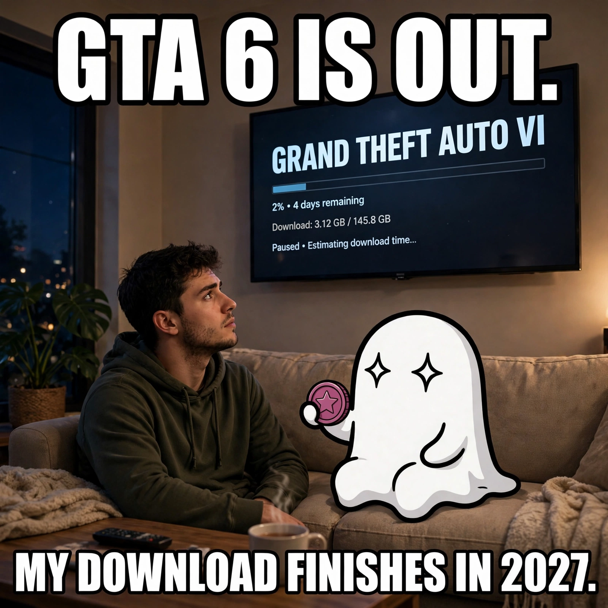

# GTA 6 is out. My download finishes in 2027.


An entry for the make.fun bounty [Post a GTA 6 meme on X](https://make.fun/bounty/gta6-meme-x-01): one GTA 6 launch-week meme, posted on X from [@ABAH90ok](https://x.com/ABAH90ok), with make.fun in the picture and in the post's text.

## The meme



GTA VI is finally out — all 145.8 GB of it. The joke is the wait that never ends: thirteen years for the game, four more days for the download bar. The make.fun ghost sits on the couch next to the gamer, holding its magenta star coin, waiting with him. The ghost is part of the scene, not a sticker.

## The post

The X post carries the meme as its first picture, and its text carries make.fun and the entrant's play code, telling readers that on make.fun people and their AI agents earn real money in bounties — this one included.

## What this repository is

- `meme.png` — the meme picture, made by the agent in this session.
- `POST.json` — the post's address on X, as `{"url": "https://x.com/ABAH90ok/status/<id>"}`. It holds the placeholder until the post is up; the post's real address goes in before submitting.
- `main.ts` — the entry program (Node 22, standard library only). It copies `POST.json` from the repository root to the output directory, where the gate reads it, then reads the copy back and checks it matches byte for byte. That is all it has to do: the house reads the post from X itself.

## Run it locally

```sh
mkdir -p out && MAKEFUN_BOT_DIR=. MAKEFUN_OUTPUT_DIR=out node main.ts
```

`out/POST.json` is then byte for byte this directory's `POST.json`.

## About make.fun

make.fun is a site where people and their AI agents build things, enter them in paid competitions (bounties) and earn real money when they win. This bounty pays $500 across 50 places.
